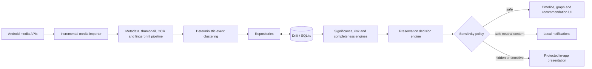

# Smart Memory — Architecture

## 1. Architectural intent

Smart Memory is an Android-focused, offline-first Flutter application. It converts
gallery metadata and on-device derived signals into editable event memories, then
uses explainable rules to recommend preservation actions.

The architecture is designed around four boundaries:

1. Device media remains owned by the system gallery.
2. Domain logic remains independent of Flutter widgets and plugin APIs.
3. Scoring and clustering implementations are replaceable behind deterministic
   interfaces.
4. Sensitivity policy is enforced before presentation and notification delivery,
   not merely represented as a UI preference.

## 2. System context



Original media bytes do not cross into SQLite. The import pipeline may request a
bounded thumbnail or temporary file from the platform when OCR or fingerprinting
needs it; that representation is released or kept only in an app-managed cache.

## 3. Architectural style

The codebase uses feature-first clean architecture:

```text
lib/
  core/
    constants/
    database/
    errors/
    security/
    services/
    theme/
    utils/
    widgets/
  features/
    onboarding/
    media_import/
    preprocessing/
    event_clustering/
    event_management/
    people/
    memory_graph/
    prediction/
    timeline/
    recommendations/
    reminders/
    privacy/
    settings/
  routing/
  app.dart
  main.dart
```

Each major feature is divided as needed:

- `domain` contains immutable entities, value objects, repository contracts, and
  use cases. It must not import plugin implementations or presentation widgets.
- `data` contains Drift models/mappers, repository implementations, platform/plugin
  adapters, and local services.
- `presentation` contains Riverpod providers/controllers, screens, widgets, and
  view state.

Small features should not gain empty layers solely for symmetry. Dependencies point
inward: presentation and data depend on domain contracts; the composition root wires
implementations.

## 4. Primary technology decisions

| Concern | Decision | Reason |
|---|---|---|
| State management | Riverpod | Explicit dependency graph, testable async state |
| Navigation | GoRouter | Declarative routing and deep-link-ready node details |
| Local persistence | Drift over SQLite | Typed queries, migrations, transactions, streams |
| Gallery access | `photo_manager` adapter | Asset-reference access without owning originals |
| OCR | Google ML Kit text recognition adapter | On-device recognition; no default upload |
| Image processing | `image` behind preprocessing service | Deterministic bounded transforms |
| Model readiness | `tflite_flutter` adapter kept optional | Enables future local models without coupling MVP |
| Graph visualization | GraphView or equivalent adapter | Interactive typed-node graph |
| Sensitive values | `flutter_secure_storage` | Platform-backed storage for small secrets/settings |
| Optional lock | `local_auth` | User-controlled biometric gate |
| Reminders | `flutter_local_notifications` | Local scheduling and neutral notifications |
| Voice notes | `record` with app-file reference | Local capture without database blobs |
| App paths | `path_provider` | Platform-safe private file locations |
| Cloud | Disabled in MVP | Local-first privacy and no mandatory credentials |

Package names express intended adapters, not verified version pins. Versions are
selected only after compatibility and dependency resolution are checked against
Flutter 3.35.4, Dart 3.9.2, API 36, and Java 21.

## 5. Build baseline

The project should retain the installed Flutter template's compatible defaults:

- Dart SDK: `>=3.9.0 <4.0.0`
- Android `minSdk`: 24
- Android `compileSdk` and `targetSdk`: 36
- Gradle: 8.12
- Android Gradle Plugin: 8.9.1
- Kotlin Gradle Plugin: 2.1.0
- NDK: 27.0.12077973
- Gradle runtime: Android Studio JBR 21.0.7

Java 26 is installed system-wide but is not the chosen build runtime. The current
`JAVA_HOME` path is invalid and must be corrected or overridden for build commands.

## 6. Domain model and persistence

### Aggregate boundaries

- An `Event` owns its title, description, cover choice, confirmation state,
  favourite/rating flags, sensitivity, and event-media memberships.
- A `MediaItem` represents a gallery asset reference plus derived metadata. It does
  not own or copy the source asset.
- `Person` and `Place` are user-confirmed context linked to events/media.
- `Note` and `VoiceNote` are contextual records. A voice note stores a private-file
  reference, duration, and metadata rather than audio bytes in SQLite.
- `GraphNode` and `GraphEdge` provide a stable projection for the interactive graph;
  domain relationships remain the source of truth.
- Score records are immutable evaluations with algorithm version, normalized inputs,
  contributions, result, and calculation timestamp.
- A `PreservationRecommendation` records its reason, proposed action, status, and
  sensitivity-safe presentation state.

### Required tables

| Table | Purpose and important constraints |
|---|---|
| `media_items` | Unique platform asset ID, type, timestamps, optional GPS/OCR/fingerprint, availability |
| `events` | Generated/confirmed title, date range, cover reference, rating, favourite, sensitivity |
| `event_media` | Many-to-many membership; unique event/media pair; deterministic ordering |
| `persons` | User-confirmed local display name |
| `event_persons` | Event/person relationship with unique pair |
| `places` | Confirmed label and optional coordinates |
| `notes` | Written context linked to event |
| `voice_notes` | Private local path/reference, duration, timestamps |
| `graph_nodes` | Typed projection ID and referenced entity |
| `graph_edges` | Typed directed relationship; indexed endpoints |
| `significance_scores` | Inputs, contributions, version, normalized score |
| `rediscovery_scores` | Inputs, contributions, version, normalized score |
| `context_scores` | Completeness flags/contributions, version, score |
| `preservation_recommendations` | Explanation, action, status, score snapshot |
| `reminders` | Local schedule, notification ID, status, safe text |
| `user_feedback` | Recommendation correction/dismissal/completion signal |
| `privacy_settings` | Local policy choices; sensitive values referenced securely |
| `scan_history` | Cursor/time range, counts, status, recoverable errors |

All tables use primary keys and creation/update timestamps where mutation is
meaningful. Foreign keys are enabled. Join keys, asset IDs, event dates, reminder
dates, recommendation status, and graph endpoints receive indexes based on query
paths.

### Migration policy

- Schema versions increase monotonically.
- Released migrations are forward-only and never rewritten.
- Destructive fallback is forbidden for user-created context.
- Each migration has a fixture from the previous schema and a verification test.
- Derived values may be recomputed only when source inputs remain available and the
  operation is explicitly versioned.
- Seed/demo data uses stable namespaced IDs and is isolated from real imports.

## 7. Service and repository contracts

Interfaces are domain-facing and return typed results/failures rather than leaking
plugin exceptions.

| Contract | Responsibility |
|---|---|
| `MediaPermissionGateway` | Report/request full, limited, denied, and permanently denied access |
| `MediaCatalogGateway` | Page through gallery assets and retrieve bounded thumbnails |
| `MediaMetadataExtractor` | Produce normalized metadata with optional fields |
| `OcrService` | Return local recognized text or a typed unavailable/failure result |
| `DuplicateFingerprintService` | Create and compare deterministic derived fingerprints |
| `VisualEmbeddingService` | Optional local embedding; capability may be unavailable |
| `EventClusteringStrategy` | Convert ordered media signals into event candidates and explanations |
| `MediaRepository` | Idempotent asset upsert, availability, and scan queries |
| `EventRepository` | Event CRUD plus transactional merge/split/membership correction |
| `ContextRepository` | People, places, notes, and voice-note relationships |
| `GraphRepository` | Build/query graph projection and resolve node targets |
| `SignificancePredictor` | Return score plus named normalized factor contributions |
| `RediscoveryRiskPredictor` | Return in-app non-rediscovery score and explanation factors |
| `ContextCompletenessEvaluator` | Return completion score and exact missing actions |
| `PreservationDecisionEngine` | Combine score snapshots into a recommendation candidate |
| `SensitivityPolicy` | Authorize preview, recommendation, and notification disclosure |
| `NotificationGateway` | Schedule/cancel neutral local notifications |
| `SecureSettingsGateway` | Store small protected settings, never media |
| `Clock` | Supply deterministic time for tests |

Future face suggestions, trained clustering/scoring models, and encrypted cloud
backup must implement separate contracts. They cannot silently replace the MVP
implementations or upload media.

## 8. Media import pipeline

1. Resolve permission state; denial routes to demo mode without an exception.
2. Read gallery assets in chronological pages.
3. Skip an item whose stable asset ID is already stored.
4. Request metadata and a bounded thumbnail, not a full-resolution image unless a
   platform adapter documents why it is unavoidable.
5. Normalize metadata; missing GPS, OCR, duration, size, or capture time is valid.
6. Run bounded-thumbnail fingerprint and OCR work sequentially with item-scoped
   failure isolation.
7. Cluster successfully derived items and atomically persist normalized media,
   event, score, recommendation, graph, and context rows.
8. Save scan start/completion/failure counts for local audit.
9. Leave resumable cursors and user cancellation as an explicit enhancement.
10. Release temporary image buffers and update observable progress.

The importer is idempotent. One malformed or unavailable asset does not roll back
all successfully imported assets.

## 9. Deterministic event clustering

### Inputs and defaults

- Strong temporal relation: gap no greater than 4 hours.
- Weak temporal relation: gap greater than 4 and no greater than 12 hours.
- Nearby location: no more than 10 kilometres when both coordinates exist.
- High OCR overlap: normalized token Jaccard similarity at least 0.40.
- Initial combined-boundary threshold: 0.45.
- Initial weights: time 0.50, location 0.25, OCR 0.15, visual 0.10.

All thresholds and weights live in a versioned `ClusteringConfig` and are test
fixtures, not scattered constants.

### Signal calculation

- Time similarity is 1.0 through four hours, then decreases linearly to 0.0 at
  twelve hours.
- Location similarity is `max(0, 1 - distanceKm / 10)` using Haversine distance.
- OCR similarity is Jaccard similarity over lower-cased, whitespace/punctuation
  normalized, stop-word-filtered tokens.
- Visual similarity is a normalized local embedding comparison only when that
  capability exists.

The combined score is:

```text
availableWeight = sum(weight of every available signal)
similarity = sum(signalScore * signalWeight) / availableWeight
```

Missing GPS, OCR, or embeddings are excluded and weights are renormalized; missing
data is not treated as negative evidence. Time is required when a reliable capture
or creation timestamp exists. If no usable comparison signal exists, the safe
default is a boundary requiring later user correction.

Media is sorted by capture time with stable asset-ID tie-breaking. Adjacent media
with similarity at or above the threshold join the current candidate event;
otherwise a new candidate begins. Each candidate stores the algorithm version and
boundary factors so behavior can be reproduced and explained. Rename, merge, split,
and membership corrections never modify source media.

## 10. Explainable scoring

Every scorer clamps inputs and output to `[0, 1]` and returns:

- the normalized inputs;
- each weighted contribution;
- the final score;
- algorithm/configuration version;
- evaluation timestamp;
- plain-language factor keys for local templates.

### Significance

```text
significance =
    0.35 * normalizedRating
  + 0.20 * favourite
  + 0.15 * normalizedRevisitFrequency
  + 0.10 * normalizedPeopleTags
  + 0.10 * normalizedAddedContext
  + 0.10 * normalizedUserCorrections
```

This is an application estimate based on user-controlled interaction signals. It is
not emotion recognition or a claim about objective importance.

### Rediscovery risk

The MVP uses a versioned weighted rule over:

- days since last in-app view;
- low total in-app view count;
- event age;
- whether a delivered reminder led to a revisit;
- dismissed preservation recommendations.

The result means likelihood of remaining unopened inside Smart Memory. It does not
predict human memory or biological forgetting. Exact normalizers and weights must
be frozen in tested configuration before release, and the explanation cites only
observable inputs.

### Context completeness

Six user-visible factors contribute equally in the initial MVP:

1. confirmed event title;
2. confirmed place;
3. at least one confirmed person;
4. written story;
5. voice note;
6. user-selected cover.

`contextCompleteness = completedFactors / 6`. Missing factors map directly to
actions such as tag people, write a story, record a voice note, confirm a place, or
choose a cover.

### Preservation need and sensitivity

```text
preservationNeed =
  significance
  * rediscoveryRisk
  * (1 - contextCompleteness)
  * (1 - sensitivity)
```

Sensitivity is also a hard authorization gate:

- hidden/sensitive events do not create unexpected lock-screen notifications;
- notification copy is always neutral, for example, “You have a memory ready to
  revisit”;
- protected previews require the configured in-app authorization;
- a formula result can never override the policy gate.

The supplied final-year project review scores—0.86 significance, 0.78 rediscovery
risk, and 0.40 completeness—are demo fixtures and are labelled illustrative rather
than validated outcomes.

## 11. State, navigation, and presentation

- Riverpod providers expose immutable feature state and inject domain contracts.
- Async controllers model idle, loading/progress, data, empty, permission-denied,
  partial-failure, and retry states explicitly.
- Widgets do not query Drift or plugins directly.
- GoRouter owns top-level navigation and typed route parameters.
- Graph nodes resolve to event/media/person/place/note/voice-note detail routes.
- Material 3 color roles and semantic labels support light/dark themes and
  accessibility.
- Generated titles/stories are visibly labelled and remain editable.

Long scans and scoring are not performed during widget build. UI progress is driven
by gateway callbacks. Scans are paged and idempotent; pause/cancel/resume is not
claimed by this MVP.

## 12. Privacy and security boundaries

### Allowed locally

- Stable gallery asset identifiers/URIs and availability state.
- Capture metadata, optional coordinates, dimensions, duration, and size.
- OCR text, fingerprints, optional local embeddings, thumbnails/cache references.
- User-created names, places, notes, voice-note file references, ratings, and tags.
- Score inputs/contributions, recommendations, reminders, and feedback.

### Forbidden by the MVP

- Original image/video bytes in SQLite.
- Media upload or cloud processing without a separate explicit opt-in design.
- Contact access without a new explicit permission and product decision.
- Automatic assignment of face identity.
- Revealing notification text for any memory.
- Treating secure storage as a media/database store.
- Deleting or mutating source gallery assets when deleting derived app data.

Deleting derived data removes normalized application rows and app-owned voice-note
files only after explicit confirmation, while retaining small privacy preferences.
Temporary OCR files are removed by their adapter. Platform gallery delete APIs are
outside that operation.

## 13. Failure handling and observability

- Plugin/platform exceptions are mapped to stable domain failures.
- Permission denial, missing assets, missing metadata, OCR failure, and model
  unavailability are recoverable states.
- Scan history records aggregate counts and sanitized error categories, not private
  OCR text in logs.
- Retry is bounded and item-scoped; deterministic failures are not retried forever.
- Database merge/split and relationship edits run in transactions.
- Notification scheduling failures remain visible in-app.
- Debug logs redact asset URIs, people names, note contents, coordinates, and secure
  values.

## 14. Performance constraints

- Page gallery queries; replace MVP snapshot writes with incremental DAO writes for
  production-scale libraries.
- Use bounded thumbnails for OCR/fingerprinting.
- Limit parallel CPU/native recognition work.
- Dispose image buffers promptly.
- Index timeline, recommendation, membership, and graph traversal queries.
- Recompute scores only when relevant inputs change or a time-based refresh is due.
- Virtualize long timelines and graph subsets.
- Never block the UI isolate with full-library processing.

## 15. Test architecture

Domain algorithms are pure Dart and receive `Clock` and configuration dependencies.
Required deterministic tests include:

- time and Haversine location similarity;
- OCR normalization/Jaccard similarity;
- missing-signal weight renormalization;
- event boundary and complete clustering fixtures;
- every significance contribution and clamp;
- rediscovery-risk boundary conditions;
- all context-completeness combinations;
- sensitivity hard-gate and preservation-need calculation;
- repository CRUD, indexes/constraints, merge/split transactions, and migrations;
- permission denied/limited/granted behavior;
- empty gallery, duplicate scans, unavailable assets, missing GPS, and missing OCR;
- timeline rendering and factor-level recommendation explanation;
- neutral notification payload generation.

Platform adapters receive integration tests where the Android environment permits.
Device behavior is not described as verified until an emulator or physical-device
test supplies evidence.

## 16. Architecture decisions

### ADR-001 — Local-first MVP

**Decision:** All required MVP behavior works without a network or paid API.

**Consequence:** Summaries are local templates and backup remains future work.

### ADR-002 — Drift, not Room

**Decision:** Persist structured data with Drift over SQLite.

**Consequence:** Flutter owns the typed database layer, migrations, streams, and
transactions without introducing an Android-native Room boundary.

### ADR-003 — References, not source media

**Decision:** Persist asset references and derived metadata only.

**Consequence:** The app remains small and non-destructive but must handle assets
that move, become unavailable, or lose permission.

### ADR-004 — Explainable deterministic MVP algorithms

**Decision:** Use versioned rule-based clustering and scoring before trained models.

**Consequence:** Results are reproducible, testable, and explainable. Optional
models can later implement the same contracts.

### ADR-005 — User-confirmed identities

**Decision:** People tagging is manual; optional face detection may locate a face
but cannot name it.

**Consequence:** No automatic identity claims or contact permission are required.

### ADR-006 — Sensitivity as policy enforcement

**Decision:** Sensitivity is checked by a central policy before previews,
recommendations, and notifications.

**Consequence:** Individual screens cannot accidentally bypass privacy by choosing
their own interpretation.

### ADR-007 — Feature-first clean architecture

**Decision:** Organize by user capability, with domain/data/presentation boundaries.

**Consequence:** Features remain independently testable and replaceable without a
single application-wide “services” layer becoming a dependency hub.

### ADR-008 — Transactional user corrections

**Decision:** Merge, split, and membership correction are repository-level
transactions.

**Consequence:** UI interruptions cannot leave orphaned or partially moved links.

### ADR-009 — Flutter template build compatibility

**Decision:** Start with Flutter 3.35.4 template defaults: API 24/36, Gradle 8.12,
AGP 8.9.1, Kotlin 2.1.0, NDK 27.0.12077973, and JBR 21.

**Consequence:** Dependency choices must adapt to a verified toolchain rather than
arbitrarily changing build versions.

### ADR-010 — Atomic normalized snapshots for the MVP

**Decision:** Serialize controller writes and replace all non-demo normalized rows
inside one Drift transaction after scans and corrections.

**Consequence:** Merge, split, add/remove-media, score, graph, recommendation,
reminder, and feedback state survive restart without partial relationships. The
simple strategy is easy to audit and test, but large libraries should move to
incremental DAO mutations.

## 17. Verified environment and deployment limitations

With Windows PowerShell added to the command process and Android Studio JBR 21 used
instead of the invalid global `JAVA_HOME`, `flutter doctor -v` completed with no
issues. Static analysis reports no issues, all 31 host-side automated tests pass,
and the debug APK builds and verifies with an Android v2 debug signature. The
overrides are documented rather than changing global machine settings. No
standalone Gradle installation is needed because the project wrapper is the source
of truth.

Host verification cannot prove Android permission dialogs, selected-photo behavior,
hardware-backed authentication, real-media OCR, microphone capture, notification
delivery, or reboot restoration. Those remain explicit device-test gates. Real
scans and edits are repository-backed and transactional; production hardening is
now about incremental write scalability, resumable scans, and device integration
coverage rather than missing persistence.
