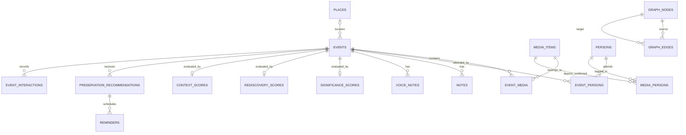

# Database schema

Smart Memory uses Drift over SQLite. Schema version 4 contains 21 normalized tables.
Timestamps represent UTC instants; Drift may materialize them in the host local time
zone, so domain comparisons normalize with `toUtc()`.

## Storage boundary

`media_items` stores Android asset identifiers, metadata, bounded-analysis results,
and availability state. It does **not** store original photo/video bytes. Voice-note
rows point to app-private audio files rather than storing audio blobs.

## Tables

| Table | Purpose |
|---|---|
| `scan_history` | Scan status, optional resume cursor, counts, permission mode, and sanitized error summary |
| `media_items` | Unique source/asset identifier, type, capture metadata, OCR, fingerprint, optional embedding metadata |
| `places` | Confirmed/manual place label and optional coordinates |
| `events` | Generated/confirmed event data, cover, rating, favourite, sensitivity, interaction summaries |
| `event_media` | Ordered many-to-many event/media membership with origin and confidence |
| `persons` | User-confirmed names only |
| `event_persons` | Event/person relationships |
| `media_persons` | Optional media/person relationships |
| `notes` | Written context linked to an event |
| `voice_notes` | App-private path, duration, and event relationship |
| `graph_nodes` | Rebuildable typed-node projection |
| `graph_edges` | Contains/attended/occurred-at/has-note/related relationships |
| `significance_scores` | Normalized score, algorithm version, evaluation time, factor JSON |
| `rediscovery_scores` | App-usage risk and factor contributions |
| `context_scores` | Completeness score and factor contributions |
| `preservation_recommendations` | Action, explanation, need, sensitivity policy, and status |
| `reminders` | Scheduled local time capsule, notification ID, neutral-content policy |
| `user_feedback` | Recommendation feedback/dismissal information |
| `privacy_settings` | Singleton local privacy/security preferences |
| `event_interactions` | Append-only views, corrections, reminder impressions/dismissals |
| `processing_jobs` | Deduplicated resumable OCR/clustering/graph/scoring work |

## Relationships

Foreign keys cascade for event-owned joins, scores, recommendations, and graph
projection rows. Removing a place sets the event place to null. A missing gallery
asset is soft-marked unavailable. Deleting a derived event deliberately retains
`media_items` references and never touches the Android gallery.

`MemorySnapshotRepository` serializes writes and replaces non-demo normalized rows
inside one transaction. This makes split/merge/membership corrections atomic while
retaining demo rows and scan audit rows. It also reconstructs the complete domain
snapshot on restart, including unassigned media, factor explanations, reminders,
and feedback.

## Indexes and constraints

Important indexes cover media capture time/fingerprint/processing state, event
start/sensitivity, both directions of junctions, graph source/target, pending
recommendations, scheduled reminders, scans, jobs, and event interactions.
Uniqueness includes source asset identity and junction composite keys. Scoring
engines clamp values to 0–1 before persistence; schema-level score checks are a
future hardening option.

## Migration strategy

- Version 4 adds `media_items.location_checked` (non-null boolean, default false)
  and nullable `places.locality`, `city`, `state`, `country`, `formatted_address`.
  Events continue to reference the existing `places` table; its latitude,
  longitude and name fields remain the canonical location storage.
- Version 3 to 4 performs additive column migrations inside a transaction. No
  memories, relationships or user context are deleted. Versions 1/2 retain the
  compatibility migration that fills missing nullable/defaulted fields and tables.
- Existing photos with GPS reuse their stored coordinates. Previously unchecked
  photos receive a single metadata check on the next scan. Missing GPS is cached;
  the scan screen provides an explicit recheck option for changed permissions.
- Production saves a consistent `smart_memory.sqlite.before-v4.sqlite` backup
  before upgrading versions 1–3, including committed WAL data. Explicit library
  deletion also removes the app's v3/v4 migration backups.
- Forward/unknown schemas fail without resetting the library. Foreign keys are
  enabled before use. Tests cover version 3 with the new columns physically
  absent, older compatibility layouts, foreign-key integrity and context retention.
- Regenerate the Drift file using `dart run build_runner build --delete-conflicting-outputs`.

## Demo seed

`DemoSeedRepository.ensureSeeded()` is idempotent and creates the supplied academic
event, 18 media references, two people, a place, graph projection, three score rows,
and one recommendation. `isIllustrative` remains true on demo score data.
